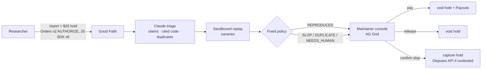

# Good Faith

**Bug bounties that survive the AI-slop era.** Back your claim with a refundable PayPal deposit, and Claude reproduces it before anyone pays.

**Live demo:** https://goodfaith-bounties.vercel.app (PayPal sandbox, so no real money moves)
**Judge mode:** https://goodfaith-bounties.vercel.app/demo (three claims settle end to end in about two minutes)
**Video:** _link added at submission_

---

## Why this exists

In January 2026 curl, which ships in billions of devices, [ended its bug bounty](https://www.theregister.com/2026/01/21/curl_ends_bug_bounty/). Its maintainers were buried under AI-generated reports that sounded authoritative and described code that did not exist. Maintainer Daniel Stenberg wanted to "remove the incentive for people to submit crap."

In April HackerOne [paused the Internet Bug Bounty](https://www.infoworld.com/article/4154210/internet-bug-bounty-program-hits--on-payouts.html): "The balance between findings and remediation capacity in open source has substantively shifted."

AI-assisted research also finds real bugs. **The problem is claims nobody can check.** Ending bounties punishes the honest researchers along with the slop.

## What it does

- **Free reports stay free.**
- **A bounty claim posts a refundable $20 deposit with PayPal.** It is an Orders v2 `AUTHORIZE` hold, not a charge.
- **Claude triages every report within minutes**, treating it as untrusted data:
  1. extracts the claims (version, files, functions, impact, proof of concept);
  2. checks every cited file and function **exists at the claimed version**, deterministically against the source tree;
  3. dedupes against reports already verified;
  4. **replays the HTTP proof of concept** against a fresh, network-isolated sandbox of the project, seeded with secret **canaries**. If a canary reaches an account that shouldn't see it, the bug is *reproduced*: a fact, not an opinion;
  5. flags instructions aimed at the AI itself (prompt injection inside a report is a hard slop signal);
  6. a **fixed, conservative policy** decides: `REPRODUCED`, `DUPLICATE`, `NEEDS_HUMAN` or `SLOP`.
- **A maintainer settles.** The AI never moves money.

| Verdict | What happens with PayPal |
|---|---|
| Reproduced | The deposit is **voided** (released in full), and the bounty is paid with **Payouts**. The `sender_batch_id` is the report id, so it pays once. |
| Duplicate, or honest but invalid | The deposit is **voided**. |
| Slop (maintainer confirms) | The deposit is **captured** into the maintainers' fund. If the researcher disputes it, Good Faith answers with the triage evidence through the **Disputes API**. |

A public transparency page counts reports, reproductions, slop caught, deposits captured, bounties paid and median time to triage.



## PayPal, end to end (all on the sandbox, all live in the demo)

| PayPal capability | Used for | Code |
|---|---|---|
| Orders v2 `AUTHORIZE` + JS SDK v6 button (browser-safe client token) | The researcher's refundable deposit | [`deposits.ts`](apps/web/lib/server/deposits.ts), [`paypal-v6.ts`](apps/web/lib/client/paypal-v6.ts) |
| Payments v2: void and capture an authorization | Release the deposit, or capture it for confirmed slop | [`settlement.ts`](apps/web/lib/server/settlement.ts) |
| Payouts v1 | Pay the bounty, exactly once per report | [`settlement.ts`](apps/web/lib/server/settlement.ts), [`client.ts`](packages/paypal/src/client.ts) |
| Orders v2 `CAPTURE` | A sponsor funds the bounty pool | [`sponsor.ts`](apps/web/lib/server/sponsor.ts) |
| Webhooks, signature-verified | Payout, authorization and dispute state | [`webhooks.ts`](apps/web/lib/server/webhooks.ts) |
| Disputes API (`provide-evidence`) | Answer a contested slop capture with the triage evidence | [`client.ts`](packages/paypal/src/client.ts) |

The PayPal client ([`packages/paypal`](packages/paypal)) is a typed REST client with a faithful in-memory mock. Every money call carries a fixed `PayPal-Request-Id`, so retries are replays. The live sandbox suite (`pnpm --filter @goodfaith/paypal test:live`) has verified:
- hold → partial capture → void;
- vaulted charges with no buyer present;
- refunds;
- payouts (including an unclaimed recipient, and a replayed batch paying nothing twice);
- dispute listing, and PayPal's acceptance of our evidence-submission request format;
- transaction search;
- webhook verification.

Notes: [docs/PAYPAL_NOTES.md](docs/PAYPAL_NOTES.md).

## AI: what Claude does, and what it is not allowed to do

**Model:** Claude Opus 5.5 through the Anthropic API ([`packages/llm`](packages/llm), provider-agnostic).

**Claude does:**
- reads the report as **spotlighted untrusted data**;
- extracts the claims, and turns free-text steps into a structured HTTP proof of concept;
- judges duplicates, suggests a CVSS severity, and scores slop.

**Deterministic code does the rest:**
- symbol lookups at the cited version;
- the sandbox replay and the canary match;
- the verdict policy ([`policy.ts`](packages/triage/src/policy.ts)): **LLM opinion alone can never make a report SLOP.** It also needs hard evidence: a cited function that doesn't exist, a version that doesn't exist, or an instruction aimed at the triager.

## Does it work? (measured, not claimed)

| Evaluation | Result |
|---|---|
| Lantern corpus: 30 reports (8 real bugs, 11 slop, 8 for human review, 3 duplicates), scripted, no keys | 30/30 correct, **0 honest reports called slop** ([results](packages/triage/evals/results.json)) |
| The same 30 reports with **live Claude Opus 5.5** | **30/30 correct, 0 honest reports called slop** ([results](packages/triage/evals/results.live.json)) |
| **curl's real reports:** 10 AI-slop reports curl received and published, plus 5 real curl CVEs, checked against the real curl source | **0 of 5 real CVEs flagged as slop.** 2 of 10 slop reports caught with hard evidence (they cite code that doesn't exist); the other 8 cite real code, so they go to a human rather than being punished automatically ([results](packages/triage/evals/results.curl.json)) |

The curl result is the honest shape of the problem. Code checks catch invented code; slop about *real* code needs reproduction or a human. Good Faith makes sure honest researchers are never charged by a machine.

## The sandbox target: Lantern

[Lantern](packages/target) is a small self-hosted notes app written for this project, in two full versions:
- **1.4.0** has three real bugs: an IDOR on notes (CWE-639), path traversal on attachments (CWE-22), and mass assignment of `role` (CWE-915).
- **1.4.1** fixes them.

Every replay builds a fresh in-memory instance: a virtual filesystem, seeded users and random canaries. There are no sockets and no outbound network, so nothing vulnerable is ever exposed.

## Run it locally (zero keys needed)

```bash
pnpm install
pnpm dev            # http://localhost:3000, mock PayPal + scripted AI, labelled MOCK in the UI
pnpm test           # all packages
```

**Live mode:** copy the variables listed in [docs/PAYPAL_NOTES.md](docs/PAYPAL_NOTES.md) into `.env.local` (PayPal sandbox app keys, `ANTHROPIC_API_KEY`), then run `GOODFAITH_MODE=live pnpm dev`.

## Repository

| Package | What |
|---|---|
| [`packages/core`](packages/core) | Shared types and zod schemas |
| [`packages/paypal`](packages/paypal) | PayPal REST client plus mock (Orders, Payments, Payouts, Disputes, Webhooks, Vault, Reporting) |
| [`packages/llm`](packages/llm) | Structured output and tool loops over Anthropic, Gemini or OpenAI-compatible APIs, with untrusted-content spotlighting |
| [`packages/triage`](packages/triage) | The triage pipeline, verdict policy, code-reference checks and evals |
| [`packages/target`](packages/target) | Lantern and the sandboxed PoC runner |
| [`apps/web`](apps/web) | Next.js app: report and deposit, live triage timeline, maintainer console (AG Grid), settlement, transparency, judge mode |

Design docs: [PLAN](docs/PLAN.md) · [CONTRACTS](docs/CONTRACTS.md).

## Built with
PayPal Orders v2 · Payments v2 · Payouts · Disputes · Webhooks · JS SDK v6 · Claude Opus 5.5 (Anthropic API) · TypeScript · Next.js 16 · React 19 · AG Grid · Hono · zod · Upstash Redis · Vercel · Vitest

## License
[Apache-2.0](LICENSE). Lantern is a deliberately vulnerable demo app; do not deploy it outside the sandbox runner.
